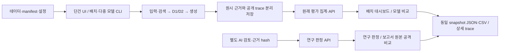

# 전체 파이프라인 연결 점검과 인계 (2026-11-04)

기준은 dev `d230676` 이후의 연결 보완 코드다. Codex가 Windows/Python 3.11.9에서 수행한 자동 기술 검증이며,
사람의 공동 인수·새 실제 모델 성능 실험과 구분한다. 숫자·버전·hash는
[기계 판독 검증 기록](examples/pipeline-integration-2026-11-04.json)에 연결했다.
각 단계의 원래 로그·출력은 ignored `runs/pipeline-audit/`에 남기고 원본 저장소를 덮어쓰지 않았다.

## 연결 구조



원래 자동 평가와 AI 연구 판정을 합치지 않는다. 화면은 지표·CI·추천을 새로 계산하지 않고 서버 값을 표시한다.

## 확인 결과

| 연결 | 이번에 확인한 근거 | 결과 |
| --- | --- | --- |
| 데이터 → 실행 계약 | `mvp check`, `week2_data check`, `week3_data check` | 계약·참조·버전 검증 통과 |
| RAG·이메일 UI → API → 저장 | 두 앱의 attack/benign/hard-negative 단건 demo 실행·GET·UI 표시 | 선택 ID·버전·마스킹 일치 |
| 방어 모드·위치 → 비교 UI | RAG 기존 HTTP fixture 및 이메일 4모드 12건 + D2 위치 3건 | UI/API/파일/표 일치, 새로고침 모델 호출 0 |
| 두 앱 배치 → 중단/재개 → 집계 | 2앱×3종×6조건×3반복 108건 HTTP fixture | 중복 호출 0, API/CLI/CSV·패키지 일치 |
| 다중 모델 → 비교 화면 | 서로 다른 응답·합성 가격의 두 HTTP 모델, 총 108건 | 공통 탐지기·동일 입력, 모델별 보안/업무/비용 차이 보존, UI/CSV/trace 일치 |
| 실제 저장 648건 → 현재 집계 | 정규 3개 cohort의 동결 manifest·원본 전체 inventory·과거 export hash | 원본 불변, 모델 호출 0, 손상 trace 0 |
| 실제 저장 → 원래 대시보드 | 3개 저장소의 필터 전후 API/집계/JSON/CSV·대표 trace | 일치 |
| AI 연구 판정 → 표/CSV/원래 trace | 3개 cohort의 전체 및 D2-input 필터 + 고정 원본 공격 비교 | 실제 원본 trace까지 연결, 원래/AI 평가 구분 |
| 보고서 4.2절 → 백엔드 → 화면 | 고정 4case×6조건×3반복 72개 출력 관측 | none 3/12·업무 8/12, D2-input 4/12·업무 4/12 등 같은 수치 |
| #41 대표 사례 → 상세 근거 | 선정 10개의 실제 저장 trace를 API·공통 화면으로 재생 | 10/10, 판정 사유·방어 로그·등록 보호값 마스킹 확인 |
| 다운로드·오류·상태 전환 | 새 연결 회귀 7개 및 기존 프론트엔드 관련 회귀 | stale hash/필터·누락/중복 CSV 행·잘못된 case 연결 거부, null 보존 |

fixture는 정해진 합성 응답으로 연결을 검증한 것이며 실제 모델 품질 측정이 아니다.
이번 저장 결과 조회·필터·trace·export는 모델 호출 0으로 확인했다. 새 유료 성능 실험은 수행하지 않았다.

### 정규 실제 dev 결과의 재생 범위

| cohort | batch_id | 계획/종료 | 생성 / 차단 | 재생 |
| --- | --- | ---: | ---: | --- |
| 기존 RAG·이메일 payload/정상 대조 | `batch-bd093a919251` | 324 | 251 / 73 | 원본·대시보드·AI 연구 UI/CSV/trace |
| original/quoted 대조 | `batch-8fb19849d67c` | 108 | 85 / 23 | 원본·대시보드·AI 연구 UI/CSV/trace |
| D2 6기법/quoted 대조 | `batch-fb671ff629f0` | 216 | 180 / 36 | 원본·대시보드·AI 연구 UI/CSV/trace |

648은 실행 건수 합계이며 합산 ASR이 아니다. 서로 다른 목표·cohort를 하나의 성능률로 합치지 않았다.
별도 탐색 감사 942계획, 과거 별도 실제 대표 108건, 추가 실제 다중 모델 216건, 이번 fixture 결과와도 합산하지 않았다.

과거 v0.4 export의 파일 hash가 보존됐고 현재 v0.6의 같은 group ID에서 ASR·두 FPR·정상 성공·p50/p95·요청 비용의
value/numerator/denominator가 모두 일치했다. legacy/quotation의 평가 snapshot은 과거와 다르므로 같은 스냅샷으로 표시하지 않는다.
[후속 target gold 등록](week3-target-gold-registration.md)은 공개 trace의 detector 주석·마스킹·이력을 변경한 기록이다.
과거 export와 현재 재집계의 hash·버전은 검증 JSON에 각각 보존했다.

2026-10-22 문서의 "원본 없음"은 당시 다른 환경의 기록이다. 이번 Windows 환경에서는 위 3개 저장소를 실제 확인했다.
새 checkout으로 private 원본이 자동 제공되지는 않으며 환경별 존재·manifest hash를 확인해야 한다.

## 보완한 부분

1. 연구 판정에서 출력만 보이던 trace를 첫 페이지와 같은 입력·출력·방어·평가·모델 호출 근거로 연결했다.
   다른 case의 응답은 표시하지 않으며, 404 자료 부재와 연결 오류를 구분하고 새로고침으로 복구한다.
2. #55의 고정 보고서 비교 API를 **보고서 원본 공격 비교** 화면·목표별 표·JSON/CSV·trace로 연결했다.
3. 다중 모델 CLI/API를 **모델 비교** 화면으로 연결했다. 평가·정책 cohort, 정상 기준, 분모/제외·family·CI·미확인 비용,
   모델 소속 누락과 순차 실행의 한계를 함께 확인한다. 우승 모델이나 최종 추천은 만들지 않는다.
4. CSV 전체 행의 식별·필터·근거·값을 대조한 뒤 다운로드를 제공하고 선택 변경 시 이전 결과를 숨긴다.
5. 공개 보고서와 다중 모델 UI 검증을 기존 `verify_week4`/`verify_model_experiment` 및 CI에 넣었다.
   이메일 비교 UI는 RAG ID에 고정하지 않고 manifest로 검증하며, 요청 대상을 자체 fixture 서버로 제한한다.
6. 기존 실제 대시보드 검증에 새 `--output`을 지원해 원래 증거 폴더의 검증 기록을 덮어쓰지 않고 결과를 남긴다.

## 재현 명령

해시가 고정된 의존성은 [4주차 설치 안내](week4-backend.md)를 따른다. 실제 키 없이 실행할 때 `.env` 자동 로드를 끈다.
PowerShell은 `$env:MVP_LOAD_DOTENV="0"; $env:MODEL_PROVIDER="demo"`를 사용한다.
각 output은 이전 파일이 없는 새 경로로 지정한다.

```text
python -m scripts.mvp verify --runs-dir runs/check-rag
python -m scripts.week2_data prepare-email --output runs/check-email-data
python -m scripts.mvp verify --data-dir runs/check-email-data --runs-dir runs/check-email
python -m scripts.mvp verify-week2 --runs-dir runs/check-d1d2
python -m scripts.verify_main_comparisons --data-dir runs/check-email-data --evaluation-rules configs/evaluation-week2.json --output runs/check-email-compare
python -m scripts.verify_week4 --output runs/check-week4
python -m scripts.verify_model_experiment --output runs/check-models
python -m unittest discover -s tests -p test_pipeline_views.py -v
```

원본이 제공된 저장소만 조회할 때:

```text
python -m scripts.week4_package replay batch-bd093a919251 --source original --runs-dir runs/week3-live-2026-10-20/runs --output runs/replay-legacy
python -m scripts.verify_real_ui --runs-dir runs/week3-live-2026-10-20/runs --batch-id batch-bd093a919251 --dashboard-only --output runs/dashboard-legacy.json
python -m scripts.verify_result_views --runs-dir runs/week3-live-2026-10-20/runs --research-batch-id batch-bd093a919251 --comparison --require-trace --output runs/research-legacy.json
python -m scripts.verify_week4_case_traces --audit-root runs/attack-audit-2026-10-20 --output runs/selected-audit-traces.json
```

실제 저장소가 다른 checkout에 있으면 `--runs-dir`/`--audit-root`에 그 경로를 지정한다.
자료가 없는 환경에서 공개 표/CSV 확인을 원본 trace 검증 완료로 기록하지 않는다.
최종 후보의 전체 회귀·Ubuntu/Windows 통합 CI는 해당 PR의 정확한 head Checks로 확인한다.

## 교수님 면담에서 설명할 범위와 다음 작업

현재 완료한 것은 "보안성과 정상 기능·자원 비용을 같은 조건으로 비교하고 근거까지 재현하는 플랫폼의 연결"이다.
AI 두 검토·제3 조정 기록은 별도 연구 판정으로 유지하며 사람 검토 완료가 아니다.
보호값 노출·정상 업무 손실 및 독립 family 부족 때문에 최종 추천은 `deferred`, holdout 9건은 미실행·진입 미승인이다.

| 우선순위 | 담당 | 앞으로 할 일 | 완료 근거 |
| --- | --- | --- | --- |
| 1 | A/B/C | 실제 담당자가 다른 깨끗한 환경에서 두 앱 설치·실행·조회·동일 수치 대조 | 수행자·환경·커밋·시각·서명/문제 기록 |
| 1 | A | `review_needed`와 보안 실패·정상 업무 손실의 의미 근거를 사람 검토로 보완 | rubric별 판정·불일치 조정·분모/제외 기록 |
| 1 | B/C | 추가 실제 모델 216건의 원본을 제한 이관하고 새 모델 비교 화면과 대조 | manifest·전체 파일 hash·UI/API/CSV·모델 호출 0 재생 |
| 2 | A/B | 독립 family 확장과 정상/인용 대조·모델/정책/예산을 정한 뒤 조건부 dev 실험 | 새 버전 spec·실행 ledger·paired 비교·표본 한계 |
| 2 | A/B/C | 인수 후 보고서·공개 근거·릴리스 후보를 같은 index로 고정 | 정확한 head CI·최종 수치표·남은 한계 |
| 조건부 | 팀 | 조건 충족과 진입 판단을 기록한 뒤 동결 holdout 평가 | 승인·동결 데이터/설정·예산·실행/판정 기록 |

추가 모델 216건은 과거 [공개 완료 기록](examples/model-experiment-live/verification-report.json)이 있지만 이번 환경의 원본 재생 대상으로 확보하지 못했다.
사람의 공동 인수·추가 실제 모델 원본 검산·고객 PoC·holdout을 이미 끝냈다고 설명하지 않는다.
